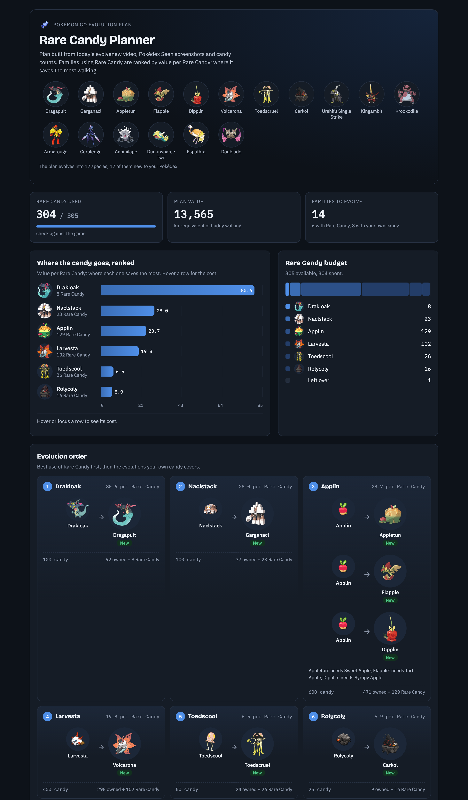

# pogo-evo-planner

[](https://github.com/kaustubhagarwal18/pogo-evo-planner/actions/workflows/tests.yml)
[](https://github.com/kaustubhagarwal18/pogo-evo-planner/actions/workflows/ci.yml)

[](LICENSE)
[](https://github.com/astral-sh/ruff)


Tells a Pokémon GO player which evolutions to do and where their Rare Candy saves the
most effort, from screenshots and a screen recording of their own game.



```
screenshot of item bag ─┐                                         ┌─► text report
                        ├─► scan (OCR) ─► inventory.json ─► plan ─┤
screen recording ───────┘                 (review/edit)           └─► HTML dashboard
```

It never logs in to or talks to the game servers, and never taps or swipes in the game.
The player moves through their own screens; this only reads them. That is the same line
long-running scanner apps stay behind, and it keeps accounts safe from Terms of Service bans.

## In your browser

**[Open the planner](https://kaustubhagarwal18.github.io/pogo-evo-planner/)** to plan without
installing anything. It opens with an example inventory and its plan, so you can see how it works,
and two ways to replace it with yours: **Upload screenshots** or **Upload inventory.json**. For
screenshots, say what you captured and pick the files:

- **the game's `evolvenew` search** (quickest): the results as you scroll, plus the Pokédex
  filtered to Seen and your item bag, as for the `evolvenew` command below;
- **your whole collection**: your item bag, storage, Pokédex and one Pokémon's page per family,
  as for `scan`.

An `inventory.json` or `evolvenew.json` that the commands saved opens the same way, or you can
start from an empty inventory and type yours in. The plan and the dashboard update as you edit, and the page
asks for anything the plan is missing: candy counts, evolution items, and Rare Candy when no bag
screenshot was read.

Everything runs inside the page, so your screenshots and inventory never leave your browser. The
planner and screen parser are this project's own Python ([Pyodide](https://pyodide.org)), and
[tesseract.js](https://tesseract.projects.naptha.com) reads the text with the same Tesseract model
the `--ocr tesseract` reader uses. On 11 real screenshots, the page gave exactly the inventory
`scan` and `evolvenew` give. The browser keeps the inventory between visits, **Download** saves it
as a file, and **Reset** removes everything the page saved and starts again from the example. The first visit downloads about 6 MB of Python from jsDelivr, and reading
screenshots the first time about 17 MB more; the browser caches both. Reading 11 screenshots then
takes about 10 s. Recordings aren't read in the browser yet: use `scan` or `evolvenew` for those.

To run it from a clone instead (after the quick start below), build it and serve it on
http://localhost:8000:

```bash
make serve
```

`make web` only builds it, into `site/`. Both use every species once `make gamemaster` has run,
and the bundled sample otherwise.

## Quick start

Requires Python 3.10+. Get the code and set it up once:

```bash
git clone https://github.com/kaustubhagarwal18/pogo-evo-planner.git
cd pogo-evo-planner
python3.14 -m venv .venv
source .venv/bin/activate
make install-ocr
make gamemaster
```

Any Python 3.10 or newer works in place of `python3.14`. `make install-ocr` runs
`pip install -e '.[ocr,dev]'` (RapidOCR and RapidFuzz), and `make gamemaster` downloads the latest
datamined game data to `data/latest.json`.

Every later session: open a terminal, `cd` into the project folder and run
`source .venv/bin/activate`. Run the commands from that folder, so they find `data/latest.json`.

### The quick way: `evolvenew`

The game already knows most of the answer. Capture three things:

1. **`evolvenew`**: in your Pokémon storage, search `evolvenew` and screen-record yourself
   scrolling through the results, or take screenshots as you scroll. They're the Pokémon whose
   evolution would be a new Pokédex entry, including ones you can't afford yet, and those listed
   only for a Mega Evolution. With screenshots, scroll less than a screen each time so the last
   row or two show again at the top of the next one: the floating buttons hide the names in the
   bottom row.
2. **The Pokédex, filtered to Seen**: screenshot the list. Those are species you've seen but
   never caught.
3. **Your item bag**, showing Rare Candy (or pass `--rare-candy N` instead).

Copy the recording and screenshots from your phone into the project's `captures/` folder (it's
kept out of git), then:

```bash
pogo-evo-planner evolvenew captures/evolvenew.mp4 captures/seen1.png captures/seen2.png \
    captures/seen3.png captures/bag.png
```

Or with screenshots of the results instead of the recording:

```bash
pogo-evo-planner evolvenew captures/results*.png captures/seen*.png captures/bag.png
```

Reading a 30-second recording takes about 3 minutes; 28 screenshots of the same results took about a
minute. The grid shows how many Pokémon the search found ("(210)" under the POKÉMON tab), and the
tool checks it read them all: "Read all 210 Pokémon your search found", or a warning such as "read
204 of the 210" when screenshots skipped rows; take more screenshots that overlap, or record the
scroll. Next it tells you which species you're missing (a real run, shortened):

```
You're missing 36 species.

Evolve into these (from Pokémon you own):
  Dragapult                                from Drakloak        100 candy, candy ?
  Garganacl                                from Naclstack       100 candy, candy ?
  Kingambit                                from Bisharp         100 candy, candy ? (needs an evolution quest)
  Urshifu (Rapid Strike or Single Strike)  from Kubfu           200 candy, candy ? (needs an evolution quest)
  ...

Catch these (seen, but nothing you own evolves into them):
  Carnivine, Chatot, Comfey, Dhelmise, Gholdengo, Gimmighoul, Hawlucha, ...

Mega Evolution only (54, need Mega Energy, not planned):
  Abomasnow, Aerodactyl, Aggron, ...

To plan your 305 Rare Candy for the rest, add each family's candy count: screenshot one
Pokémon's page per family, or use --candy NAME=N:
  Applin, Bellsprout, Blipbug (e.g. Dottler), Charcadet, Dreepy (e.g. Drakloak), ...
```

Next it asks for those candy counts, one family at a time, then for the evolution items the
missing species need (apples, Sinnoh Stone, lure modules…):

```
18 families need a candy count. For each, type the number, or the path of a screenshot of that
Pokémon's page (you can drag the file in), or press Enter to skip; q stops.
Nacli candy (Naclstack → Garganacl needs 100): 72
Dreepy candy (Drakloak → Dragapult needs 100): captures/drakloak.png
  read 92
...
3 evolution items are needed. For each, type how many you have (Enter if none; q stops).
Sweet Apple (Applin → Appletun): how many? 23
...
```

The candy count is shown on any Pokémon's page in that family. With the answers it prints the
Rare Candy plan, saves the answers, and shows the `--candy` and `--item` options that skip the
questions next time (`--candy Naclstack=72` takes a Pokémon's name or its family's;
`--item "Tart Apple=26"`). `--no-ask` only lists what's missing. The plan looks like this:

```
Rare Candy: 110 of 305 used

Evolve now with your own candy:
  Floette → Florges Red (needs an evolution quest)

Use Rare Candy:
  Drakloak → Dragapult  +8 Rare Candy
  Larvesta → Volcarona  +102 Rare Candy

Not yet:
  Applin → Flapple: needs Tart Apple: if you have one, add --item "Tart Apple=N"
  Snom → Frosmoth: 298 candy short (have 102 of 400) (evolve at night; needs an evolution quest)
```

"Use Rare Candy" lists the best use first: value per Rare Candy, so 8 Rare Candy that finish
Dragapult come before 102 for Volcarona. "Evolve now" doesn't depend on Rare Candy: an evolution
your own candy covers is listed however few Rare Candy you have. Only evolutions into species
you've never caught are planned, one form per Pokédex entry, and Rare Candy is never spent on a
family whose candy count is unknown. Detail pages count as Pokémon you own, one per CP, so
include a page for each copy of a Pokémon with several evolutions (Applin, Eevee) you'd evolve.
What was read and answered is saved to `evolvenew.json`; `--dashboard plan.html` also writes the
HTML dashboard.

#### Known issue: Pokémon with several evolutions

`evolvenew` lists a Pokémon when **at least one** of its evolutions is new, but the tool treats
every branch as new. A Charcadet is listed because Ceruledge is new, so the plan also suggests
Charcadet → Armarouge, although the player owns two Armarouge (an owned Armarouge isn't on the
`evolvenew` list, so the tool can't see it). Check branching Pokémon (Charcadet, Kubfu, Applin,
Eevee…) in the game before evolving; a detail-page screenshot shows each branch's silhouette.

#### Known issue: nicknamed Pokémon

OCR reads the name under each Pokémon in the grid, never its picture, and the grid shows a
Pokémon's nickname rather than its species. A nickname that looks like another species is read
as that species. Two cases from the real run above:

- A Victreebel, on the list for Mega Victreebel and nicknamed "99%Bellsprou…", is read as a
  Bellsprout, so **Weepinbell is reported missing although the player owns one**.
- A renamed Doublade is read as a Honedge, so **Doublade is reported missing (it's owned) and
  Aegislash, the species really missing, isn't listed at all**. A nickname can hide a gap, not
  just add a false one.

A name half-hidden behind the floating buttons at the bottom of the screen can be misread the
same way (a Houndoom read as "Houndour").

Until this is fixed, clear nicknames on the Pokémon in your `evolvenew` results before
recording, and check any surprising entry in the game. The planned fix is to recognise the
Pokémon from its picture with a local vision model through Ollama (see the roadmap).

### The full scan

To plan from your whole collection instead (including species you caught once but no longer own):

```bash
pogo-evo-planner scan bag.png recording.mp4 -o inventory.json
```

Review `inventory.json`. Add any candy counts the scan missed under `"candy"`: a family without one
gets no Rare Candy, because its count is unknown, not 0. Add evolution items under `"items"`, by
the names the game shows, like `{"Sinnoh Stone": 1, "Tart Apple": 26}`. Then plan:

```bash
pogo-evo-planner plan inventory.json
```

Or write the same plan as a self-contained HTML page (ranking, candy budget, paths, inventory):

```bash
pogo-evo-planner dashboard inventory.json -o dashboard.html --open
```

`pogo-evo-planner scan ... --dashboard dashboard.html` scans and writes the dashboard in one go.

Every command uses `data/latest.json` when it exists; without it (not run from the project
folder, or before `make gamemaster`) they fall back to a small bundled sample, and every species
missing from it (all of Paldea, for example) is silently dropped. `--species` picks another file.

Scanning took about 1.5 s per frame with RapidOCR on an Apple Silicon laptop. A recording is sampled at
3 fps, so a few minutes of scrolling can take 10+ minutes to scan. `--fps 1` is about three times
faster but can miss screens you scroll past quickly. Once `inventory.json` exists, `plan` and
`dashboard` run in about a second; no need to rescan.

No RapidOCR? `make install` uses Tesseract (`apt install tesseract-ocr` /
`brew install tesseract`) and Python's difflib instead: slower, less accurate.

Try it without the game, from a fresh terminal:

```bash
cd /path/to/pogo-evo-planner
source .venv/bin/activate
make demo
make mock
```

`make demo` runs the planner on an example inventory. `make mock` renders synthetic screens and a
recording, scans them, and plans.

See [docs/CAPTURING.md](docs/CAPTURING.md) for what to record.

## Example output

```
Rare candy: using 150 of 150  (value score 14,367)

== Spend rare candy on ==
Feebas family: 100 candy (30 owned + 70 rare) - saves ~1,400 km of buddy walking
   Feebas -> Milotic
      Milotic: walk 20 km as buddy first
Dratini family: 100 candy (60 owned + 40 rare) - saves ~200 km of buddy walking
   Dragonair -> Dragonite
...
== Trade instead of spending candy ==
   Haunter -> Gengar is free when traded
```

## Example dashboard (a real player, today)

The dashboard for a real player, built with `evolvenew` from one screen recording of the
`evolvenew` results (210 Pokémon), three Pokédex "Seen" screenshots, the candy counts typed in
when asked, and the apples from one detail page. It's the picture at the top of this README.

| Use Rare Candy (best use first) | Rare Candy | Candy needed (owned + Rare) |
|---|---|---|
| Drakloak → Dragapult | 8 | 100 (92 + 8) |
| Naclstack → Garganacl | 23 | 100 (77 + 23) |
| Applin → Appletun, Flapple, Dipplin (with apples) | 129 | 600 (471 + 129) |
| Larvesta → Volcarona | 102 | 400 (298 + 102) |
| Toedscool → Toedscruel | 26 | 50 (24 + 26) |
| Rolycoly → Carkol | 16 | 25 (9 + 16) |

Eight more families evolve with the player's own candy alone (Kingambit, Krookodile, Ceruledge,
Annihilape, Dudunsparce, Espathra…). 304 of 305 Rare Candy is used; the last one can't finish
any remaining evolution (the smallest gap is 39). Two suggestions are known bugs (see "Known
issue" above): Charcadet → Armarouge, though two Armarouge are owned, and Honedge → Doublade,
where the "Honedge" is a renamed Doublade.

## How it works

Full walkthrough, with diagrams, of how missing species are found and how evolutions are
ranked: [docs/ARCHITECTURE.md](docs/ARCHITECTURE.md).

### Scanning (`pogo_evo_planner/scan/`)

| Step | Module | Notes |
|---|---|---|
| Frames | `frames.py` | Samples recordings at 3 fps, collapses pauses into one sharpest frame, keeps every scroll frame. |
| OCR | `ocr.py` | RapidOCR (PaddleOCR models on ONNX) by default; Tesseract fallback reads 3 passes (2 polarities + upscaled) and merges. Returns word boxes. |
| Screens | `screens.py` | Classifies each frame (bag / detail / Pokédex / storage) and parses it relative to labels the game always shows, not fixed pixel regions. Species names are fuzzy-matched. |
| Merge | `pipeline.py` | Votes across frames, de-duplicates storage cells by (species, CP), reports conflicts and gaps. |

What each screen provides:

- **Item bag** → Rare Candy count (ignores Rare Candy XL).
- **Pokémon detail page** → that family's candy (`60` above `DRATINI CANDY`). Neither the
  storage grid nor the Pokédex shows candy, so one detail page per family is needed. The
  Candy XL count beside it is ignored, including on narrow phones where its label wraps
  onto two lines, and a candy label whose long name wraps ("GREAVARD" above "CANDY"). The
  **Evolve button** also shows whether you've ever caught the evolution: a flat dark
  silhouette means never caught, a Pokémon in colour means caught. The button's own colour
  (green, grey, pink, blue-grey) doesn't matter; the sprite is judged against it. A frame
  where the sprite hasn't loaded yet is left out, and each species is decided by a majority of
  frames, so one misread frame doesn't decide. A silhouette is saved under `not_caught` and
  overrides a storage reading of that species (the grid sometimes pairs a name with the wrong
  cell). Read for single-evolution species; "evolve" in hint text and MEGA EVOLVE buttons are
  ignored. Checked against 39 real buttons in `tests/real/evolve_buttons/`.
- **Storage grid** → owned species and CP per cell. A cell whose CP is scrolled off is
  skipped; another frame will have it whole. After a search, the count under the POKÉMON tab
  ("(210)") is read too, and the scan warns when fewer Pokémon than that were read.
- **Pokédex** → filtered to **Seen** (the filter button in the game's Pokédex), every entry
  shown is a species you've seen but never caught, saved under `not_caught`. Screenshots of
  that list are the quickest way to get a never-caught list. Unfiltered, caught vs. only-seen
  is guessed from sprite colour (not yet tried on real screens). The status bar and the
  "Caught: N" count are not read as dex numbers. Species you've never even seen aren't on the
  "Seen" list, so the Evolve button is still needed for those.

### Reading screens with an LLM (optional, `pogo_evo_planner/scan/llm.py`)

Instead of OCR, a vision LLM can read each frame as an image and return a structured reading:
screen kind, Rare Candy, species, candy, the Evolve button's sprite, storage cells, Pokédex
entries. It can identify a nicknamed Pokémon from its sprite, which OCR can't. Everything after
that (merging frames, planning) is unchanged. OCR stays the default; `--ocr llm` picks the default
LLM, which is Ollama. Two models are supported:

| | `--ocr llm` / `--ocr ollama` (default LLM) | `--ocr claude` |
|---|---|---|
| Model | runs on your machine with [Ollama](https://ollama.com); default `qwen3-vl:4b` | Claude (`claude-opus-5-5`) through the Anthropic API |
| Cost | free | paid per frame (rough, unmeasured estimate: a few cents each) |
| Privacy | nothing leaves your machine | screenshots go to Anthropic |
| Speed / accuracy | slow on a laptop; small models read less accurately | faster and more capable |

Install the extras (the Anthropic SDK, the Ollama client and Guardrails AI):

```bash
pip install -e '.[llm]'
```

Free and local: install Ollama from https://ollama.com and start it, then pull the model
(3.3 GB; it fits an 8 GB Mac, and `qwen3-vl:2b` is 1.9 GB) and scan:

```bash
ollama pull qwen3-vl:4b
pogo-evo-planner scan bag.png detail.png --ocr llm --species data/latest.json
```

Paid, with Claude (`ant auth login` works instead of setting the key):

```bash
export ANTHROPIC_API_KEY=...
pogo-evo-planner scan bag.png detail.png --ocr claude --species data/latest.json
```

`--llm-model` picks another model for either backend.

Every reading is checked with [Guardrails AI](https://github.com/guardrails-ai/guardrails)
before it's used: names must match a species in the game data (after the same fuzzy matching
OCR text gets), CP must be 10–10,000, counts must be in range, Pokédex numbers must exist, and a
bag screen must have a Rare Candy count. If anything fails, the model is asked once more with the
list of failures. Values that still fail are dropped and reported as scan warnings. Guardrails'
own usage telemetry, which is on by default, is switched off, so validation runs locally and
sends nothing (a test checks this).

Because Claude is paid, a Claude scan of more than 60 frames is refused unless you raise
`--llm-max-frames`; a screen recording yields hundreds of frames. Neither backend has been run
against real captures yet; the tests use fake clients.

### Planning (`pogo_evo_planner/planner.py`)

- Cost per candy = buddy km × rarity multiplier (`data/rarity_tiers.json`, hand-tuned:
  spawn rarity isn't in the game data).
- An evolution is worth candy cost × cost per candy, plus a bonus for a new Pokédex entry,
  but only when it gives you a species you don't already own. That value is the same however
  the species is reached (the candy from the family's first stage), so evolving a middle stage
  you own beats starting over from the first stage. Owning a later stage counts as having
  the earlier ones, and a plain name like Maushold covers all its forms (the storage grid
  never shows the form). Rare Candy is only spent to complete an evolution into a species you don't
  have, never on a repeat and never just to use it up; repeats only use own candy left over
  after that. A repeat evolution is worth
  nothing by default (`--repeat-value 0.1` keeps 10%, `1` turns the discount off). Species
  you own count as registered.
- Only the first Pokémon of each species is planned for; later copies are dropped, and IVs
  are ignored. A species whose line branches (Eevee, Kirlia, Charcadet) keeps one copy per
  final evolution you don't own yet, so each copy can take a different branch.
- Per family, a DP over those Pokémon and their evolution paths (multi-step, branched)
  gives (candy needed, items used, value) options. Across families, a grouped knapsack
  spends the Rare Candy and shared items (Metal Coat, Sinnoh Stone, lures) for maximum value.
- Partial top-ups are never suggested: Rare Candy only pays off when it completes an
  evolution. The text report lists trade evolutions as "trade instead". Verified against
  brute force.
- A family with no candy count gets no Rare Candy: its count is unknown, not 0. The text report
  names those families.

### Dashboard (`pogo_evo_planner/dashboard.py`)

Renders the same plan as one self-contained HTML file from `pogo_evo_planner/data/dashboard.html`:
the species the plan evolves into, summary, families ranked by value per Rare Candy (best use
first), the Rare Candy budget, evolution order (with a "New" tag where an evolution adds a
Pokédex entry), and the Pokémon left out of the plan (an extra copy of a species being evolved
isn't listed). It flags families whose candy count wasn't scanned. Pokémon sprites and artwork load from
[PokeAPI's sprite repository](https://github.com/PokeAPI/sprites) by national dex number when
online; offline, each shows its initial instead. The file lists your Pokémon, so it is gitignored
like `inventory.json`.

### Browser app (`web/`, `pogo_evo_planner/webapp.py`)

A static page with no server code. A web worker loads Pyodide and unpacks the planner package
(`planner.zip`) into it. The page sends the inventory as JSON to `webapp.WebPlanner`, which
plans it with the same `planner.plan`, `cli.render` and dashboard as the commands do. The
dashboard is shown in a sandboxed frame. Screenshots go through `webapp.WebScan`: Python makes the
same three Tesseract passes as `--ocr tesseract`, tesseract.js reads them in the page, and
`scan.pipeline.scan` parses and merges the screens as the command does, with `apply_evolvenew` on
top for the `evolvenew` way. `scripts/build_web.py` assembles the site: the page, the
package, the species table (normalized from the game master) and the example inventory. It stamps
a build id into the page so browsers fetch changed files rather than cached ones. The **pages**
workflow builds it with the latest game master and publishes it on GitHub Pages.

## Data

- `pogo_evo_planner/data/species_sample.json`: ~65 hand-entered species for tests and demos.
  **Not authoritative**; use `make gamemaster` for real data.
- `scripts/fetch_gamemaster.sh`: downloads PokeMiners' datamined `latest.json`;
  `gamemaster.py` parses it (candy cost, buddy km, items, lures, trade flags, conditions).

## Status

MVP. The planner is solid. The scanner's automated tests use **synthetic** screens
(`tests/mockscreens.py`), which mimic the text layout but aren't real captures. A first real
recording (576×1296 phone screen) found two problems, both fixed: unknown species being dropped
with the sample data, and the wrapped Candy XL label being read as regular candy. It also led to
the Evolve-button silhouette check. Expect more calibration on other phones; OCR still garbles
some CP values and the storage grid sometimes pairs a name with a neighbouring cell's CP. The
optional LLM readers (`--ocr llm` / `ollama` / `claude`) haven't been run on real captures yet,
so their accuracy, speed and cost are unknown. Nicknamed Pokémon can be read as the wrong
species; see "Known issue" under the `evolvenew` quick start. See [docs/ROADMAP.md](docs/ROADMAP.md)
for what's next and [CHANGELOG.md](CHANGELOG.md) for what each version changed.

## Development

- `make test`: all tests, including end-to-end OCR (about 30 s).
- `make test-fast`: skips the OCR end-to-end test.
- `make lint`: ruff (lint, and a check that the code is formatted), pylint, mypy, bandit,
  codespell, and gitleaks if installed.
- `make format`: formats the Python code with `ruff format`. Run it before committing, rather
  than formatting by hand.
- `make web`: builds the browser app into `site/`; `make serve` also serves it at
  http://localhost:8000.

Linter settings and pinned linter versions live in `pyproject.toml`, so `make lint` runs what CI
runs. Three GitHub Actions workflows run on GitHub:

- **tests** (`.github/workflows/tests.yml`): everything in `tests/` with pytest, on pull requests
  (including from forks), on pushes to `main`, and by hand from the Actions tab for a branch
  without a pull request. `test` uses the Tesseract backend on Python 3.10 to 3.14;
  `test-rapidocr` uses RapidOCR (non-blocking).
- **ci** (`.github/workflows/ci.yml`), on pushes to `main` and on pull requests: `lint` (ruff,
  ruff format, pylint, mypy, bandit, codespell) and `secrets` (gitleaks over the full git
  history).
- **pages** (`.github/workflows/pages.yml`): builds the browser app with the latest game master
  and publishes it on GitHub Pages, on pushes to `main`, every Monday (so new species arrive
  without a code change) and by hand. It needs Pages switched on once, under Settings → Pages →
  Source: GitHub Actions.

Not affiliated with Niantic, Scopely, Nintendo or The Pokémon Company.
