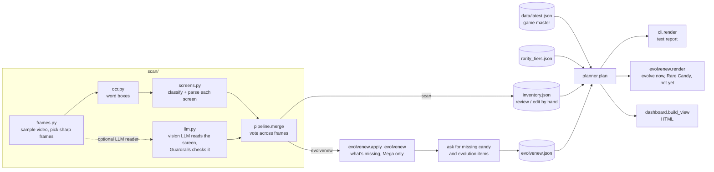
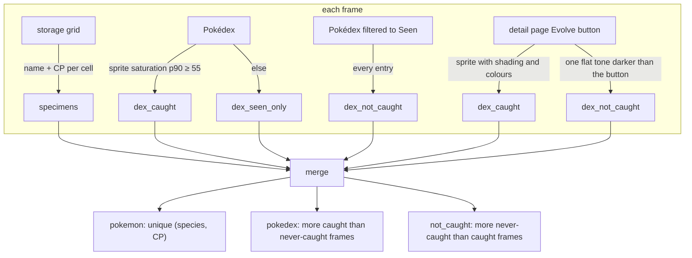
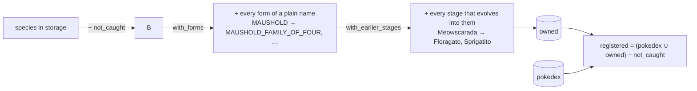
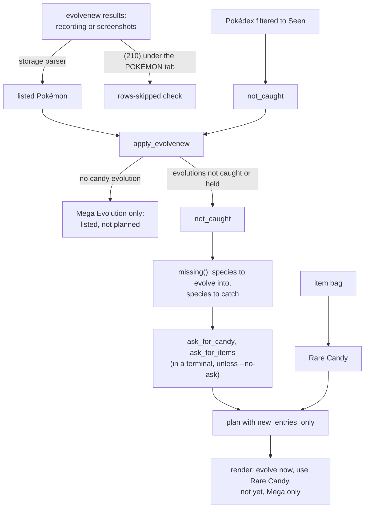
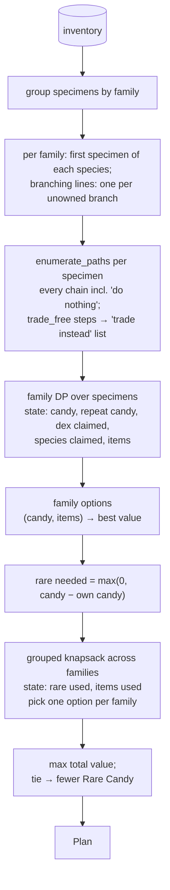
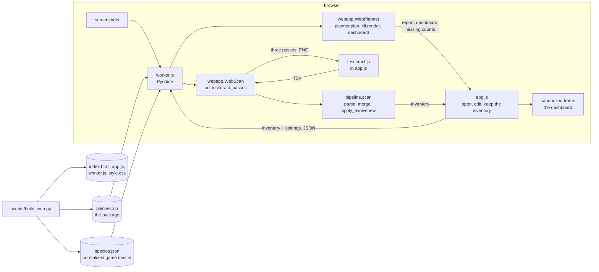

# Architecture

How `pogo-evo-planner` turns screens into a ranked evolution plan, focused on the two parts
that decide the result: **finding what the player is missing** and **ranking what to evolve**.
The README's "How it works" section is the short version; this is the long one.

Two commands share the same scanner and planner:

- **`evolvenew`**, the quick way: it reads only what the game's `evolvenew` search lists, plus
  the Pokédex "Seen" list and the item bag, then asks for the candy counts it needs (2d).
- **`scan`, then `plan` or `dashboard`**: it reads the whole collection into an `inventory.json`
  that the player reviews and edits by hand.

The browser app (6) runs the same planner on an inventory either command saved, inside the page.



OCR (`ocr.py` + `screens.py`) is the default reader. The optional LLM readers in `llm.py` replace
both steps: a local model through Ollama (the default LLM, free) or Claude (paid) returns a
structured reading per frame, which Guardrails AI checks before it becomes the same per-screen
result the OCR parsers produce. Merging is the same either way.

Every arrow after `inventory.json` is deterministic and runs in about a second, so the
planner can be re-run after hand edits without rescanning.

## 1. Inputs

| Field in `inventory.json` | Comes from | Meaning |
|---|---|---|
| `rare_candy` | item bag screen | Rare Candy held (Candy XL ignored) |
| `candy` | Pokémon detail page, one per family | candy per family, keyed by first stage (`DRATINI`) |
| `pokemon` | storage grid | owned specimens (species + CP) |
| `pokedex` | Pokédex screen, coloured Evolve buttons | species ever caught |
| `pokedex_seen_only` | Pokédex screen | seen but never caught (informational) |
| `not_caught` | silhouette on an Evolve button | species never caught; overrides storage |
| `items` | typed by hand | evolution items (Metal Coat, Sinnoh Stone, lures), by name or game id |

The species table (`gamemaster.py`) supplies each species' family, dex number, buddy km,
evolutions (candy, item, notes, `trade_free`) and rarity class.

## 2. Finding what's missing

"Missing" means two different things, and the planner rewards them separately:

- **Not owned:** no specimen of that species in storage. Evolving into it earns the species
  value (the candy it stands for).
- **Not registered:** never caught, so not in the Pokédex. Evolving into it also earns the
  Pokédex bonus.

A species can be registered but not owned (caught once, since transferred or evolved).
Evolving into it then earns the species value but no Pokédex bonus.

### 2a. Evidence from the screens (`scan/`)



- `screens.evolve_sprite_caught` judges the sprite left of the EVOLVE label against the button
  around it, whatever the button's colour: it takes the button colour from the box (leaving out
  the white page past the button's rounded end), keeps the pixels that differ, and measures how
  much their lightness varies. A silhouette is one flat tone (≤ 7 on real buttons), a Pokémon in
  colour has shading and highlights (≥ 15); the cut-off is 11. Fewer than 100 differing pixels
  means the sprite hasn't loaded, and the answer is `None`. Checked against 39 real buttons
  (`tests/real/evolve_buttons/`).
- `screens.evolve_buttons` keeps only the capitalised EVOLVE label: not "evolve" in hint text
  ("Adventure together to evolve") and not MEGA EVOLVE.
- `merge` decides each species by majority: more caught than never-caught frames puts it in
  `pokedex`, the reverse in `not_caught`, and a tie in neither (with a warning).
- Storage cells are de-duplicated by `(species, CP)`. Cells read without a CP are counted
  per frame and only added beyond what CP-bearing cells already cover.
- If a species is both in storage and in `not_caught`, the scan warns that the grid probably
  paired a name with the wrong cell. The planner trusts the silhouette.

### 2b. Owned and registered sets (`planner.py`)



- `with_forms`: the storage grid never shows a form, so a plain name covers every form with
  the same dex number. A specific form (`OINKOLOGNE_FEMALE`) covers only itself.
- `with_earlier_stages`: owning a later stage implies you had the earlier ones, so evolving
  into them isn't new.

### 2c. Gaps in the data

These don't change the plan by themselves. They're reported so the player can fill them in:

| Check | Where | Triggers when |
|---|---|---|
| `families_missing_candy` | planner, used by scan and dashboard | a family has no candy count **and** an owned member can still evolve, at any depth, into a species not in `owned`. Families that can't reach anything new are left out because their candy doesn't matter. |
| `unknown_species` | `plan()` | a scanned species isn't in the species table (usually because the bundled sample was used instead of `data/latest.json`) |
| storage vs. silhouette | `scan()` | covered in 2a |
| no bag screen | `scan()` | Rare Candy defaults to 0 (`evolvenew` stops instead and asks for `--rare-candy`) |
| rows skipped | `merge()` | after a storage search, fewer Pokémon were read than the count under the POKÉMON tab ("(210)"): screenshots or fast scrolling skipped rows |

### 2d. The `evolvenew` shortcut (`evolvenew.py`)

The game's `evolvenew` storage search lists every Pokémon with at least one evolution that would
be a new Pokédex entry. That includes ones the player can't afford yet, and final forms listed
only for a Mega Evolution. The `evolvenew` command reads that list instead of the whole
collection:



- `apply_evolvenew` marks each listed Pokémon's evolutions as never caught, unless the Pokédex
  reading shows them caught or the player holds one (nobody is missing a species they hold).
  A listed Pokémon with no candy evolution is there for its Mega Evolution, which costs Mega
  Energy, not candy, so it is reported but not planned.
- `missing()` gives one row per Pokédex entry: forms share an entry, and the cheapest route is
  kept. Each row is either a species to evolve into (with the Pokémon the player owns and the
  candy cost) or a never-caught species nothing owned evolves into, which has to be caught.
- The grid shows no candy counts. The command asks for each family's count, as a number or a
  screenshot of that Pokémon's page, and for the evolution items the missing species need. It
  saves the answers to `evolvenew.json` and prints the `--candy` and `--item` flags that skip
  the questions next time.
- Planning uses `new_entries_only`: only evolutions into never-caught species count, and the
  forms of one Pokédex entry count once. A family without a candy count gets no Rare Candy
  (see 4b).
- Known limits, from the README's "Known issue" sections:
  - every branch of a branching Pokémon is treated as new;
  - a nickname is read as whichever species it looks like.

## 3. Valuing an evolution

All value is in **km-equivalent effort**: how far you'd walk a buddy to earn the same candy.

```
cost_per_candy(family) = buddy_km × rarity multiplier
```

The multiplier comes from `pogo_evo_planner/data/rarity_tiers.json` (or `--tiers`): common 1, uncommon 1.5, rare 3,
very rare 5, legendary 10. Families not listed there fall back to legendary if the game data
marks them legendary or mythical, and to common otherwise. Spawn rarity isn't in the game
data, so the tiers are set by hand.

For one evolution path (a specimen and the chain of steps it takes):

| Term | Value | Condition |
|---|---|---|
| species value | `candy_from_base(final) × cost_per_candy` | the final species isn't in `owned` and nothing else in this family already claimed it |
| repeat value | `path candy × cost_per_candy × repeat_value` (0 by default) | otherwise; only own candy may pay for it |
| Pokédex bonus | `dex_bonus` (20) per new entry | each species on the path not in `registered` and not already counted in this family |

`candy_from_base` is the cheapest candy from the family's first stage to that species. The
species value is the same however the species is reached, so finishing from an owned middle
stage costs less candy for the same value, and the cheaper route wins.

Worked examples from a real scan (all rarity tier common, multiplier 1):

| Family | Evolution | Candy spent | Target owned? | Registered? | Value |
|---|---|---|---|---|---|
| Nacli | Naclstack → Garganacl | 100 | no | no (silhouette) | 125 × 5 + 20 = **645** |
| Dreepy | Drakloak → Dragapult | 100 | no | no (fixed by hand) | 125 × 5 + 20 = **645** |
| Toedscool | Toedscool → Toedscruel | 50 | no | no (silhouette) | 50 × 3 + 20 = **170** |
| Clobbopus | Clobbopus → Grapploct | 50 | no | yes | 50 × 3 = **150** |

Garganacl spends 100 candy but is valued at 125, because reaching it from Nacli would cost
125. Grapploct is registered but not owned, so it earns the species value without the Pokédex
bonus. The scan had marked Dragapult as caught from an Evolve button, but the player never caught
one, so it was removed from the Pokédex list by hand; it now earns the bonus too.

## 4. Ranking: choosing what to evolve

The choice is an exact optimisation, not a greedy sort, in two stages.



### 4a. Per family (`family_options`)

1. `keep_specimens` keeps one specimen per species, the first listed, and drops later
   duplicates. A species whose line branches (Eevee; Kirlia → Gardevoir or Gallade; Charcadet →
   Armarouge or Ceruledge) keeps one copy per final evolution you don't own yet, so each copy can
   take a different branch. This keeps the DP small. IVs are ignored. Worst case: 8 Eevees with
   lures and no Eeveelutions owned takes about 6 s; a typical inventory plans in under a second.
2. `enumerate_paths` lists every path from each specimen, including multi-step and branched
   ones, plus the empty path. Steps marked `trade_free` are not taken; they go to the
   "trade instead" list (unless `allow_trade_evolutions`).
3. The DP adds specimens one at a time. Each path can be scored as a repeat or, if its final
   species is unowned and unclaimed, as a new species. States that exceed own candy + Rare
   Candy or the items held are dropped.
4. At the end, a state is discarded if its repeat candy is more than the own candy the new
   evolutions leave over. This is the rule that **Rare Candy is never spent on a repeat**.
5. The best value is kept for each `(candy, items)` pair. Those pairs are the family's options.

### 4b. Across families (`plan`)

Each option needs `max(0, candy − own candy)` Rare Candy. A grouped knapsack takes one
option per family (the empty option is always available), with total Rare Candy ≤ what's held
and shared items within stock. It returns the state with the highest total value and, on a
tie, the one using less Rare Candy.

A family with no candy count gets no Rare Candy at all. Its count is unknown, not 0, and reading
it as 0 would spend Rare Candy on the whole cost of an evolution the player may already afford,
or may be far from. `plan()` lists those families in `no_candy_count`, and the text report names
them. `rare_candy_blocked_families` can block more families on top of these.

Because value only comes from completing an evolution, the optimiser never suggests a
partial top-up and never spends Rare Candy just to use it up. In the real scan above it
used 123 of 305 Rare Candy and left the rest.

### 4c. Presentation order

The optimiser picks the set; display order is a separate step:

| Output | Grouping | Order |
|---|---|---|
| `evolvenew` text (`evolvenew.render`) | "Evolve now", "Use Rare Candy", "Not yet", "Mega Evolution only" | Rare Candy rows by value per Rare Candy (best use first) |
| `plan` text report (`cli.render`) | "Spend rare candy on", "Already affordable with your own candy", "Trade instead" | Rare Candy used, then value |
| dashboard (`data/dashboard.html`) | needs Rare Candy / own candy only | Rare Candy families by value per Rare Candy (best use first), own-candy families by value |

The dashboard also lists the Pokémon left out of the plan ("Not planned") and any species
missing from the species data.

## 5. Settings

| Setting | Default | CLI flag | Effect |
|---|---|---|---|
| `dex_bonus` | 20 | `--dex-bonus` | km-equivalent value of a new Pokédex entry |
| `repeat_value` | 0 | `--repeat-value` | share of value kept by evolving into a species already owned |
| `allow_trade_evolutions` | off | `--allow-trade-evos` | spend candy on evolutions that are free by trading |
| `new_entries_only` | off | set by `evolvenew` | only evolutions into never-caught species count; the forms of one Pokédex entry count once |
| `rare_candy_blocked_families` | none | — | more families that may only use their own candy (a family without a candy count already is) |

## 6. The browser app (`web/`)

The page is static: no server code runs, so any static host can serve it. The planner's own Python
runs in the browser through Pyodide, and neither the screenshots nor the inventory leave the page.



- **Worker.** `worker.js` is a module worker. It loads Pyodide from jsDelivr, unpacks `planner.zip`
  and builds one `WebPlanner` with the species table. A long plan never freezes the page. While one
  plan runs, only the newest edit waits for the next one.
- **The JSON boundary.** Every method the page calls is a `@json_api` method in `webapp.py`. Its
  arguments arrive as one JSON object of keyword arguments, and its plain Python reply goes back as
  JSON, so nothing needs converting between JavaScript and Python. A mistake the player can fix
  raises `InputError`, which becomes `{"error": message}`; the worker's `api()` turns that into an
  error the page shows. Any other exception is a bug, shown as "The planner hit an error".
- **What `WebPlanner` returns.** `plan_json` gives the text report, the dashboard page and the
  Rare Candy totals. It also lists what the plan is missing: families without a candy count
  (`families_missing_candy`), and evolution items the inventory doesn't list that an owned Pokémon
  needs, at any depth, to reach a species the plan counts as new (`items_to_ask`, by the planner's
  own `gives_new_species`: with new entries only, a species already registered doesn't count). An
  unlisted item is unknown, so the page asks for it, as it does for a missing candy count. An
  inventory that isn't valid raises `InputError`, naming what's wrong.
- **Start.** A first visit opens the bundled example (`inventory_sample.json`) under a start card
  offering the two ways in: screenshots or an inventory file. The example is replaced without a
  question; the player's own inventory only after they confirm. **Reset** forgets everything the
  page kept in the browser (inventory, settings, the screenshot summary) and goes back to the
  example.
- **Editor.** `app.js` checks a file as it opens, keeping fields it doesn't use so a download gives
  back everything. It normalizes names to ids ("Mr. Mime" to `MR_MIME`), refuses species and items
  the species table doesn't have, and flags rows the plan will skip. It saves the inventory and the
  settings in the browser's `localStorage` (the page still works if storage is off). It plans again
  250 ms after the last edit.
- **Screenshots.** The page asks what was captured, as the two commands do: the `evolvenew`
  search or the whole collection. The worker loads NumPy and OpenCV (Pyodide builds) the first
  time, and makes a `WebScan` over a folder in Pyodide's file system. Each screenshot is written
  there with its own modification time, which `taken_at` falls back on as it does for a file on
  disk. Python makes the command line's three passes (`ocr.tesseract_passes`: grey, negative,
  upscaled). tesseract.js reads them in the page with the same "fast" English model, in page
  segmentation mode 11, as the command line. Its TSV comes back through `ocr.words_from_tsv` and
  `ocr.merge_passes`, and `pipeline.scan(read_text=...)` takes those words instead of running OCR.
  So parsing, merging, the Evolve-button check and the warnings are the command's own code. Fed the
  command line's own TSV, `WebScan` gives exactly `scan`'s inventory; with tesseract.js, it did too
  on 11 real screenshots. The `evolvenew` way adds `apply_evolvenew` and plans new entries only.
  The page asks for the Rare Candy count when no bag screenshot was read, rather than plan with 0.
- **Dashboard frame.** The dashboard HTML goes into an `<iframe>` sandboxed without
  `allow-same-origin`, so its scripts can't reach the page or its storage; its links open in a new
  tab. A small script added to it reports its height, so the frame fits it.
- **Build.** `build_web.py` zips the package with fixed dates, so the same files give the same
  bytes. It stamps a hash of every file into `index.html` as the build id, and the page adds that
  id to every URL it loads, so a deployment is never mixed with cached files. It refuses to replace
  an output folder it didn't build.

## 7. Where to look

| Concern | Code |
|---|---|
| frame sampling | [`scan/frames.py`](../pogo_evo_planner/scan/frames.py) |
| screen parsing, Evolve-button and Pokédex colour tests | [`scan/screens.py`](../pogo_evo_planner/scan/screens.py) |
| LLM readers (Ollama, Claude) and their Guardrails checks | [`scan/llm.py`](../pogo_evo_planner/scan/llm.py) |
| merging frames, scan warnings | [`scan/pipeline.py`](../pogo_evo_planner/scan/pipeline.py) |
| owned / registered sets, valuation, DP, knapsack | [`planner.py`](../pogo_evo_planner/planner.py) |
| game master parsing | [`gamemaster.py`](../pogo_evo_planner/gamemaster.py) |
| the `evolvenew` flow: what's missing, the questions, the plain-words plan | [`evolvenew.py`](../pogo_evo_planner/evolvenew.py) |
| commands, their error messages, text report | [`cli.py`](../pogo_evo_planner/cli.py) |
| dashboard data | [`dashboard.py`](../pogo_evo_planner/dashboard.py) |
| what the browser app calls: plan JSON, missing counts, catalog, screenshots (`WebScan`) | [`webapp.py`](../pogo_evo_planner/webapp.py) |
| Tesseract's passes and TSV, shared by the command line and the browser | [`scan/ocr.py`](../pogo_evo_planner/scan/ocr.py) |
| the browser app's editor, worker and styles | [`web/`](../web/) |
| building the site; publishing it | [`scripts/build_web.py`](../scripts/build_web.py), [`pages.yml`](../.github/workflows/pages.yml) |
